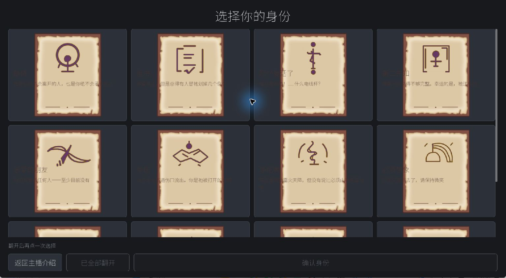
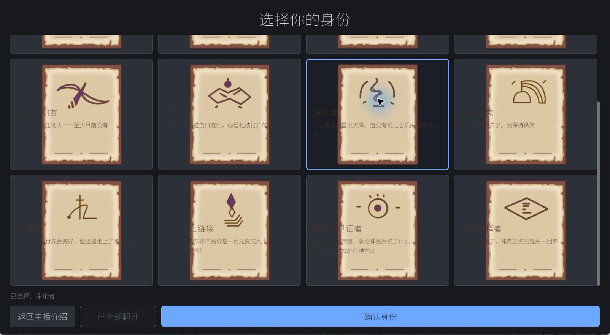
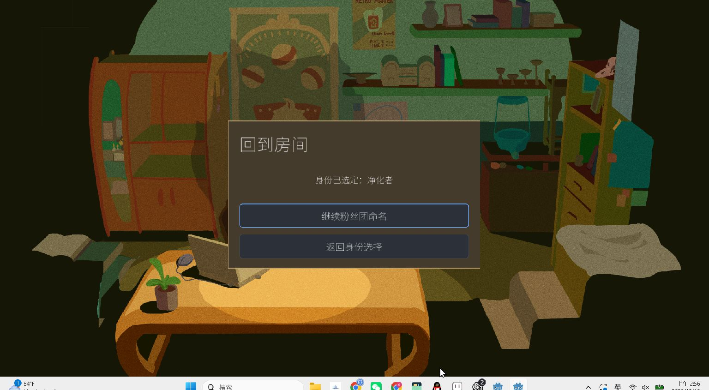

# 身份系统 ID-15 视觉 QA 日志

日期：2026-10-19

结论：**REWORK**。#271 候选的卡片点击和下一步可用；卡面与按钮尺寸不一致，文字没有完整落在卡面内，初次进入时第一排还被滚动位置裁切。

## 测试范围

- 目标 PR：[ #271 · 美术归档、青蛙切图修正及 12 身份卡临时映射](https://github.com/w7775p/Empty-start/pull/271)。PR 仍为 open；本 QA 没有合并或修改该 PR。
- 实际运行代码：`chore/art-intake-20261019`，完整提交 `22d89c453f74f3d4fb933bcae6e51b229d90b79e`。本次只启动一轮 Godot 游戏窗口。
- Godot：`4.7.2.stable.official`。工程逻辑视口 `1920×1080`，stretch 为 `canvas_items / expand`。Windows 显示器报告 `1920×1080 @ 60 Hz`；Computer Use 返回的窗口截图为 `1536×845` 逻辑像素，实际 Godot client rect 未单独取得。
- `1280×720` 未测。此次运行窗口占满可用桌面区域，窗口还原和拖动尝试没有改变尺寸；没有重启第二轮来改窗口大小。
- #272 中的 [ID-15 任务卡](tasks/ID-15_identity-card-fixed-size-and-screen-fit.md) 写着现有卡片最小尺寸 `280×260`；被测 `22d89c45` 的 `identity_selection.gd` 实际设为 `280×350`。QA 结论针对实际测试代码，D 实施 ID-15 时应先核对该尺寸差异。

## 操作路径与结果

Godot Boot → 主菜单“开始游戏” → 使用默认主播名 → “继续选择身份” → 身份卡页 → “一键翻开” → 选择“净化者” → “确认身份”。最终身份保存没有执行；`SaveManager.new_game()` 只创建内存中的新 `SaveData`，本次停止在房间转场页。

| 项目 | 结果 | 观察 |
|---|---|---|
| 初始卡背 | **PASS（观察）** | 身份页显示统一卡背；初始状态截图没有保留到证据目录。 |
| 一键翻开 | **PASS** | 十二张卡面均能翻开，通过上下滚动检查三排。单卡背面首击翻开本次没有独立测试。 |
| 卡片选择 | **PASS** | 点击“净化者”后出现蓝色选中框，状态文字显示“已选择：净化者”。 |
| 下一步 | **PASS** | “确认身份”可点击并进入“回到房间”转场页；屏幕显示“身份已选定：净化者”和“继续粉丝团命名”。没有继续到最终身份保存。 |
| 初次滚动位置 | **REWORK** | 身份页刚打开时第一排卡片大部分在可见区域之外；手动向上滚回顶部后第一排完整显示，向下滚动可达第三排。底部导航留在可见区域。 |
| 卡片边界与文字 | **REWORK** | 四列按钮横向扩展到整列宽，卡面贴图仍按纵向比例居中，导致按钮选中框明显宽于图案。截图中卡片标题/描述以按钮宽度排版，部分文字落在图案外的深色区域；长描述贴边、可读性差。未见内容溢出窗口边缘，问题集中在卡片内部边界与首排初始可见性。 |

### 对应实现位置

- `ui/identity_setup/identity_selection.tscn`：`Margins/Content/CardScroll/IdentityCards` 为四列网格，`CardScroll` 负责垂直滚动。
- `ui/identity_setup/identity_selection.gd::_ready()`：Button 最小尺寸为 `280×350`，同时使用 `SIZE_EXPAND_FILL`；`CardArt` 设为 `STRETCH_KEEP_ASPECT_CENTERED`；`CardFace/Front` 的内容随按钮区域布局。
- `ui/identity_setup/identity_selection.gd::_fit_layout()` 与 `_scroll_to_card()`：进入时调整容器缩放并滚动到焦点卡片。初始第一排裁切，建议 D 核对这两处和布局完成时序，确保首次进入从滚动顶端显示。

## 截图证据

Computer Use 通过 Windows Graphics Capture 实际截取游戏窗口。图像尺寸为截图 API 返回的逻辑像素；Windows 显示器为 `1920×1080`。

## 给 D 的 ID-15 处理建议

1. 先统一 Button、卡背贴图、卡面内容的实际宽高与内边距，避免 GridContainer 横向扩展后贴图仍保持较窄纵向比例；按任务卡允许的 4 列优先、小屏调整列数或滚动。
2. 将标题和完整描述约束在卡面内容宽度内并自动换行；检查“净化者”等长描述的边缘、行距和实际可读性。
3. 确保身份页首次打开时 `CardScroll` 从顶部开始；保留向下访问第三排、标题/状态/导航固定可触达的行为。
4. ID-15 后续验收覆盖 `1920×1080`、`1280×720` 和一档更小窗口，并单独验证单卡首击翻开、正面选中、键盘焦点与下一步。此次 `1280×720` 和单卡首击保持 **UNVERIFIED**。

## PB-10 依赖准备

#271/A 合流前没有运行 Windows 包。合流后按最终完整 SHA 调用 `tools/build_internal_playtest.ps1 -Platform Windows -DestinationRoot 'D:\Godot\PB-10-Playtest' -ExpectedCommit '<完整 SHA>'`；最短验收核对生成的 `Windows_Release` 中 EXE、PCK、README 和交付资源，再做一次隔离 EXE 启动 smoke。当前仍待 A 合流后执行。

## 状态

- QA 结果：**REWORK**，建议 D 按 ID-15 修正卡片实际尺寸、卡内排版和进入时的初始滚动位置。
- 本次只写报告与三张最少截图；未修改 D/A 游戏代码，未重新运行项目、未构建包。
- `chore/art-intake-20261019` 在 QA 期间前进到 `1474eed2`，该提交只合入 #272 的任务卡；`identity_selection.gd` 与被测版本相同。截图对应实际运行的 `22d89c45`。
- Godot console/stdout 未收集；无可见错误对话框。引擎日志错误状态 **UNVERIFIED**。
