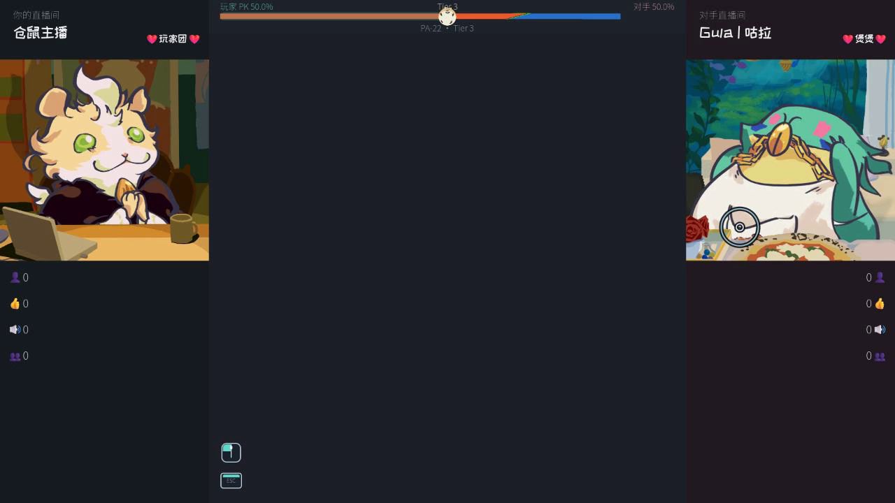
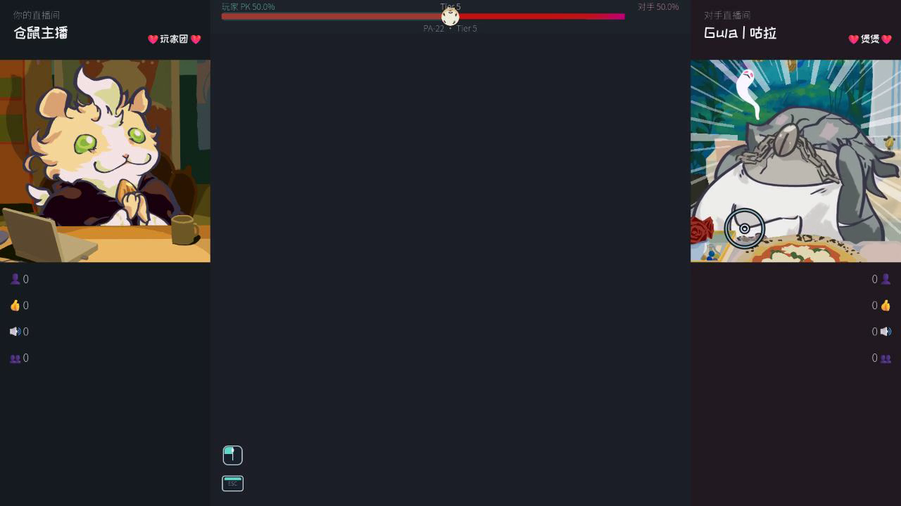
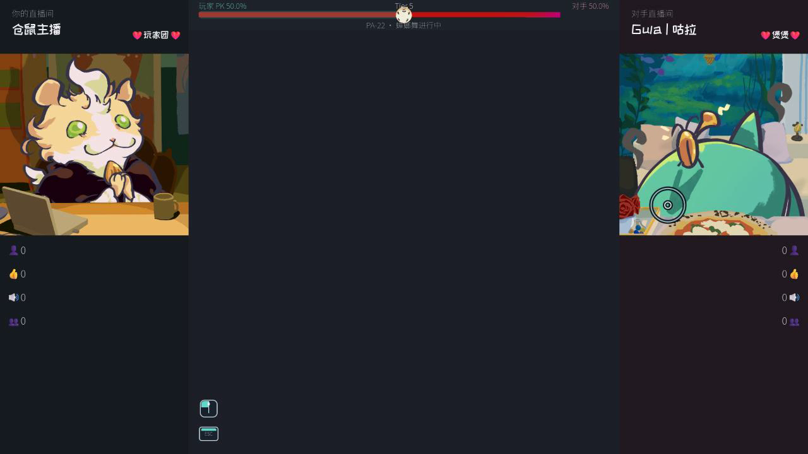

# PresentationAssets 表现资产接入

## PTF-04 立绘与 PK 视图修复（2026-10-16）

`OpponentTierPortrait` 在 PTF-04 曾使用同角色全套 alpha 边界共同缩放，使较短/较窄的阶段图明显缩小。**PA-23-FIX 现按每张原图完整画布的宽高比适配直播框**，恢复 PA-14 的显示尺度：保留原图比例、翻牌 Pivot、角色专属修正系数；同时将可见主体底边放在 `(0.5,1.0)` 站立线上（保留 5px 画面内安全距离），四周预留 5px 边距，较高姿态优先完整显示。PA-17 的过渡和击败图继续调用 `fit_current_texture()`。Fox 的 `level_004.tres.streamer_live_background` 已引用仓库存在的 `fox/background.png`。最终视觉取舍由策划验收。

HUD 的 PK 输入统一走 `refresh_pk()`；`on_tier_changed()` 只播放档位动作，避免晚到旧 PK 再写入进度动画。`get_pk_display_snapshot()` 同时提供真实输入、平滑显示、皮肤和百分比文本；原 0.16 秒显示动画保留。超宽父框改为等比缩放/居中，人物、字体和准心保持比例，Android 物理安全区仍由 A/E 提供。

截图、两种对白策略视频及真实输入限制见 [PTF-04 日志](../../Integration/直播表现_PTF-04_2026-10-16_log.md)。

## INT-18D 两档实际分辨率验收（2026-10-16）

HUD 在 `configure_opponent_result(level, presentation)` 中消费正式 `LevelProfile.streamer_live_foreground`；新前景层位于角色之后、对白之前，同属右侧 CRT 覆盖范围。`configure_opponent_foreground(texture)` 可独立替换，`reset_for_attempt()` 清理旧前景。降档震动幅度/时长现在读取 06 表，缺项保留 Inspector 配置。

原重播场景增加 `--int18d`：真实普通命中、五档立绘、PA-17 动画/静帧/离线、动画中复位、PA-12 结果漫画、评论/气泡/教学及音频事件均通过。`--preview-small` 为实际 1280×720；默认验收为无边框精确 1920×1080，避免 Windows 标题栏裁切。两档各 48 张真实 PNG 和总线 WAV 仅保存在 `D:\Godot\verification\int18d-20261016\hd-verified`、`small-final`，可复播入口仍为 `tests/presentation/int17d_production_presentation_smoke.tscn`。

人工艺术验收、正式根场景最终组合及平台边界见 [INT-18D 日志](../../Integration/INT-18D_2026-10-16_log.md)。

## INT-17D 正式 HUD 结果表现（2026-10-16）

`SandboxBattleHud` 已实例化 PA-17 子场景，绑定既有右侧立绘与 PA-14 动效层，局部覆盖层 z=21，高于 PA-11 CRT 的 z=20。`configure_portrait_character()` 同时配置待机与 PA-15 角色特效，修复角色 ID 未传入 Tier 层的问题。

- 每次 `reset_for_attempt()` 后调用 `configure_opponent_result(level: LevelProfile, presentation: Dictionary = {}) -> bool`。使用关卡 T5/过渡/击败纹理；正式映射来自 `FormalSheetRuntimeConsumer.get_level_presentation()` 的 `portrait_tiers`、`portrait_defeat`、`portrait_defeat_transition`。Fox 复用已交付的四张玫瑰图。
- CB 结果锁定后调用 `play_opponent_result(broken: bool) -> bool`，成功启动后等待 `opponent_result_presentation_finished(broken)`。Alien/Fox/Kiwi 复用原动画，Frog 显示正式击败静帧。未击破保留 T5 并呈现局部离线；重开会清理演出。
- **INT-16 根场景待接线**：先开启既有 `_result_feedback_active` 暂存、调用 Flow 的 `hold_oracle_for_result_feedback()`；PA-17 完成后播放原 PA-12 结果漫画，再由原漫画完成回调释放神谕/Rest。未击破 Rest 可能同步到达，必须在播放前开启暂存。

可复播验收入口：`tests/presentation/int17d_production_presentation_smoke.tscn`。它实例化完整正式 Sandbox，并在验收层示范上述接线；生产 `sandbox.gd` 保持由 INT-16 拥有。当前正式根场景尚需采用这些调用。证据与精确验证结果见 [INT-17D 日志](../../Integration/生产集成_INT-17D_2026-10-16_log.md)。

> **统一派工入口**：[2026-10-09 任务卡整合与依赖顺序](../../开发计划_2026-10-09_任务卡依赖整合.md)。开发前核对该表、本卡现行版、main 实际实现及最新完成日志。


## 已交付美术资产

当前 PNG 资产分类、命名、数量及引用入口见 [assets/README.md](../../../assets/README.md)。旧位置的 PNG 已按用途重新归类，后续美术接入从此清单查找最新路径。

## 当前制作与集成安排（2026-10-10）

策划正在考虑调整 Sandbox 的场景组织方式。PA-04～PA-06、PA-08～PA-19 的**独立程序美术资源、视觉组件、可调参数和完成通知**可按任务推进；需要集中修改 Sandbox、BattleHud 和跨系统生命周期的接线，由后续确认的场景集成负责人依据新结构完成。当前的演出需求与分支结果以各任务卡为准。

PK 条贴图按 PA-16 规则：**玩家 PK 低于 40% 显示负向素材，40% 及以上显示最新 Tier 素材**。角色动画先采用 PA-14 的整图通用待机首版、PA-17 的 Kiwi 整图变形首版。现有粉丝牌纹理继续用于 LD-15 直播评论粉丝标识；主播信息区按 PA-20 使用「主播名    ❤粉丝团名❤」文字布局，PA-10 负责最终整屏视觉验收。

## PA-14 双主播整图动效（2026-10-10）

`systems/presentation/streamer_portrait_motion.gd` 使用绑定节点的原生 Tween：外层负责一次射击事件，内层负责循环漂浮、呼吸与微摆，PNG 本体可继续叠加其他表现。HUD 在 `_ready()` 为已有左右 TextureRect 插入这两层；原有素材显示接口继续使用缓存的立绘引用。运行时立绘路径增加 `<PortraitArt>Motion/Idle`，集成代码应使用现有 HUD API 或 `%PlayerPortraitArt` / `%OpponentPortraitArt`，避免硬编码旧子路径。

Lane A 后续接线：

```gdscript
# HUD 已进入树后，绑定本场正式攻击来源；重复调用自动解除旧连接。
battle_hud.bind_portrait_attack(attack_charge_input)
battle_hud.configure_portrait_character("alien") # 支持 alien / kiwi / fox
```

`bind_portrait_attack(null)` 可解除来源。`play_player_shot(snapshot)` 仅应接正式 `shot_snapshot_created`；每发只走绑定或直接转发中的一种入口。当前 Lane E 按分工保留 `sandbox.gd` / `sandbox.tscn`，完整战斗的发射接线 **TO VERIFY / 待 Lane A 集成**。待机已由 HUD 自动启用。

`refresh_pk()` 按 Tier 控制对手：T0 隐藏立绘及占位文字，T1 起显示当前 PNG；专属离线流程可调用 `set_opponent_portrait_connected(false)`。背景、汗滴、翻图、受击和 CRT 继续由对应卡负责。替换阶段 PNG 会复用当前动效层。

可通过公开 `player_portrait_motion` / `opponent_portrait_motion` 调参：

| 参数 | 默认 / 预设 | 作用 |
| --- | --- | --- |
| `idle_period` / `idle_phase` | 玩家 3.4s / 0；alien 3.8s / 2.2；kiwi 2.9s / 1.7；fox 4.1s / 3.2 | 周期 / 弧度相位；修改后 `restart_idle()` |
| `float_distance` / `breath_amount` / `sway_degrees` | 2～4px / 1.5～2.5% / 0.5～0.8° | 角色预设待机强度 |
| `body_pivot` | (0.5, 0.65) | 相对槽尺寸的躯干枢轴；随尺寸变化更新 |
| `shot_direction` / `shot_distance` / `shot_compression` | 向右 / 9px / 6% | 前冲方向、距离、压缩 |
| `recoil_count` / `recovery_seconds` | 2 / 0.18s | 后坐次数、最终回弹；默认总动作约 0.395s |

`set_idle_strength(0.0)` 平顺减弱待机，事件结束调用 `set_idle_strength(1.0)` 恢复；外部 CRT / 受击请作用于原立绘槽或 PNG 本体，保留 PA-14 两个容器的变换归属。`reset_for_attempt()` 取消射击 Tween、恢复幅度并隐藏对手。

Windows 验证入口为 `tests/presentation/pa14_portrait_motion_smoke.tscn`：继承正式 Sandbox Scene，仅在测试场景覆盖组合脚本，使用真实攻击输入、Timer 与 HUD；测试时长 / 分辨率处理仅存放于 `tests/`。Godot 4.7.2 Windows GUI 与 headless 各 23 项通过，GUI 实际 PNG 为 1920×1080。Android 硬件、项目默认 D3D12、PA-09 / PA-11 完整同屏演出仍 **UNVERIFIED**。详见 [PA-14 日志](表现资产_PA-14_2026-10-10_log.md)。

## PA-15 对手阶段立绘组件（2026-10-10）

`systems/presentation/opponent_tier_portrait.gd` 附着在 PA-14 的对手待机层中，保留原 `OpponentPortraitArt`。`refresh_pk()` 读取运行 Tier：T1 idle，T2 idle 加循环下滑淡出的程序汗滴，T3～T5 对应变化图 01～03，T6 保留变化图 03。不同底图在横向收窄的中点换图并短促弹出漫画冲击线；T1↔T2 只抖动和增减汗滴。快速改档会取消旧翻转，落到最新 Tier。

正式关卡集成方先调用原 `configure_streamer_assets()`，再调用 `configure_opponent_tier_textures(idle, tier_01, tier_02, tier_03)`；现有 CombatStage → Sandbox → `refresh_pk()` 的阶段通知继续驱动画面。四张图由关卡配置提供；当前 `LevelProfile` 尚未接入策划 02/23 表，因此示例关卡只有 idle 占位。三名角色的现成图片和映射见 `assets/README.md`。独立演示场景为 `scenes/demos/pa15_portrait_demo.tscn`，正式 HUD 冒烟为 `tests/presentation/pa15_hud_smoke.tscn`。详见 [PA-15 日志](表现资产_PA-15_2026-10-10_log.md)。

## PA-22 青蛙分件挣扎与蟑螂舞（2026-10-20）

`FrogSlicedPortrait` 以完整立绘维持 PA-23 锚点，只用 `FrogBodyMotionRoot` 变换整组分件。身体、金链、围裙/装饰和对应 Tier 分件相对站立基线统一上移 15 个 1920×1080 设计逻辑像素；1280×720 预览按 2/3 比例显示。T3/T4/T5 挣扎只影响青蛙分件，其他对手共用布局和尺寸规则不变。

- T3/T4/T5/T6 的挣扎强度依次为 0.34/0.62/0.88/1.0。
- 金链作为 `FrogBodyMotionRoot` 子层继承身体位移、压缩和旋转；局部位置与角度增加轻微滞后，缩放继承一次。
- `OpponentTierPortrait.play_frog_cockroach_dance()` 手动启动蟑螂舞；`frog_cockroach_dance_finished` 表示本轮完成。演示场景按 `1` / `2` / `3` / `4` 切换 T1/T3/T4/T5，按 `D` 重播舞蹈，按 `R` 复位。
- 正式演出触发继续由既有阶段/演出事件Owner接线；PA-22 不新增敌方技能或战斗状态。

Godot 4.7.2 Movie Maker 实录为 1280×720、30 FPS、124 帧。实际 v2 MP4：[下载 PA-22 Frog Preview v2](https://github.com/w7775p/Empty-start/releases/download/pa22-frog-preview-20261020/pa22-frog-preview-v2.mp4)。SHA-256：`EED23B51B4743CF25148120860ADA897453BCAD39B2A432FD5754C0EC989D270`。

真实录像帧：







实现、回放和交接限制见 [PA-22 任务日志](表现资产_PA-22_2026-10-20_log.md)。

## PA-23 主播立绘可见底边锚点（2026-10-20）

原 PA-23 的 alpha 可见底部中点 `(0.5,1.0)` 锚点方案已经由 PA-23-FIX 替代，现有默认 `(0.5,1.0)`，并按**单张原图宽高**适配 432px 直播镜头。PA-14 的 `body_pivot=(0.5,0.65)`、翻牌、受击与 PA-17 击败时序保持原值。仓鼠仍采用坐姿及桌沿遮挡。原 PA-23 图仅作为历史对比，正式结果见 [PA-23-FIX 日志](表现资产_PA-23-FIX_2026-10-20_log.md)。

真实 Godot 截图按修改前、修改后分别保存在 [`previews/pa23-ground-anchor/`](previews/pa23-ground-anchor/)，包含仓鼠射击动作和四名对手的 T1、T3、T5、击败状态；当前采用 D3D12 / AMD Radeon、1920×1080、Godot 4.7.2。详细验证与交接见 [PA-23 日志](表现资产_PA-23_2026-10-20_log.md)。

## PA-07 取消记录（2026-10-11）

**策划决策：PA-07 已取消。** 保留现有攻击流程及反馈；实体言弹外观、飞行特效与专用快照坐标接口从开发范围移除。历史试样留在未合并的 #142。

## PA-12 漫画转场独立组件交付（2026-10-12）

`systems/presentation/paradox_comic_transition.tscn` / `.gd` 提供独立 Paradox 漫画层：压暗噤声、双道不规则斜切、交叉闪白和放射冲击线、描边硬影标题过冲回弹、左右锯齿撕幕，以及“击破！”/“未击破”结果字。`transition_finished` 通知揭幕完成，`result_feedback_finished(success)` 通知结果反馈完成；不保存阶段或结算状态。所有分镜时长、颜色、切角、带宽、闪白、冲击线、标题字体/字号/描边与幕布边缘都可在 Inspector 调整；默认时间合计约 3.6s。

独立预览为 `scenes/demos/pa12_paradox_comic_demo.tscn`：F6 运行，`R` 重播漫画转场，`1` / `2` 重播两种结果字。画面复用 Sandbox HUD、左右真实立绘、准心、`BarrageArea` 与 `BarrageView`；普通弹幕读取样例 LevelProfile，六句矛盾候选读取 `tests/fixtures/contradiction_break/test_cb_13_six_candidates_level.tres`，揭幕后调用 `BarrageArea.start_contradiction_generation()`，完成信号后调用真实 `ContradictionBreakSystem.start_window()`。普通流程时间与结果字由演示脚本编排，不代表已接入完整战斗结果。

原分支 Windows Godot 4.7.2 AMD Radeon OpenGL 兼容渲染的真实截图曾用于人工验收；预览媒体不随本次合并入库，正式截图保存于仓库外 `D:\tmp\pa12-rework-preview-20261015`（之后由 Demo 默认写入 Godot `user://pa12_previews/`）：1920×1080 七帧覆盖普通战斗、噤声、交叉闪白、撕幕、揭幕和成败结果；1280×720 两帧核对揭幕与结果字的缩放。演示运行与画面见 [PA-12 日志](表现资产_PA-12_2026-10-12_log.md)。

**正式流程联调待办：** 当前 `ContradictionOracleFlow.entered` 在矛盾生成与 10 秒窗口启动之后才发出；`outcome_resolved` 发出后流程会继续打开神谕或 Rest。现有接口无法在演出前暂缓生成/计时/输入，也没有等结果漫画结束再继续的回调。正式接线需要阶段流程在转场完成后启动候选与窗口，并在结果反馈完成后恢复后续流程；PA-12 本卡未修改 `sandbox.gd`、`sandbox.tscn`、ContradictionBreak、PA-11 或 PA-15。

## 目标

让程序可以稳定接入美术正式资源，同时保持占位素材和正式素材可以直接替换。

当前资产目录：

```text
assets/
├── characters/
├── environment/
├── fonts/
└── ui/
```

共享表现配置为 `data/shared/presentation_asset_config.tres`，保存跨场景共用的 UI Theme 和玩家主角外观引用。需要显式读取共享资源时使用 `PresentationAssetConfig` 对应字段；项目级默认主题仍由 `project.godot` 的 `[gui] theme/custom` 应用。

## 当前规则

各玩法系统的数据 Resource 继续直接保存自己使用的美术资源引用。

例如：

- `IdentityOption.icon` 保存身份图标；玩家主角跨场景复用的立绘、头像、直播背景、房间背景和粉丝牌由 `PresentationAssetConfig` 保存。
- `LevelProfile` 保存每关主播的立绘、头像、直播背景和粉丝牌；主角固定外观不写入样例对手关卡。
- 败者卡资料保存卡面；
- 结局配置保存教派主图；
- UI Theme 保存通用字体和控件样式。

常见资源归属：

| 资源目录 | 内容示例 | Resource 归属 |
| --- | --- | --- |
| `assets/characters/` | 主播立绘、头像、身份/神明图标、败者卡角色图 | 身份、关卡/主播或败者卡 Resource |
| `assets/environment/` | 直播背景、房间背景、转场画面 | 关卡或对应演出配置 Resource |
| `assets/fonts/` | 项目专用字体文件 | 共享 Theme 或排版配置 Resource |
| `assets/ui/` | 跨场景状态图标、准心和通用 UI 贴图 | 共享表现配置；单系统图标归该系统 Resource |

身份图标继续存放在 `IdentityOption.icon`；每关主播立绘、头像、背景和粉丝牌跟随 `LevelProfile`；玩家主角固定外观因会跨场景复用而放在 `PresentationAssetConfig`；败者卡卡面跟随败者卡资料；教派主图跟随结局配置。系统专属资源仍由对应系统 Resource 持有。

`player_streamer_avatar` 当前复用主角立绘纹理；交付独立头像后只替换该字段。PA-02 只建立 Resource 引用，Sandbox HUD 与背景的实际视觉接线由 PA-03 处理。

跨多个场景共同使用、并且需要集中替换的表现素材放进共享表现配置。

## 替换约定

- 占位资源和正式资源使用同一个字段；美术交付后替换该字段对应的 Godot Resource。
- 共享配置只添加已被多个场景共同使用的素材；新增前先核实实际消费者。
- 当前没有共享准心、状态图标、通用转场贴图或 Shader 资源，因此不预建这些字段。
- 不创建 AssetManager 或额外查找服务；需要时通过系统 Resource 字段或显式加载共享配置取得资源。

## 任务

本表作为本程序美术 Agent 的独立执行待办。**PA-14 已交由另一位开发者负责，2026-10-10 起从本 Agent 待办移除**；原 PA-14 任务卡仍由仓库保留供对方开发和最终集成核对。本 Agent 后续跳过该卡。

| 任务卡 | 功能 | 单元测试 |
| --- | --- | --- |
| PA-01 | 建立表现资产引用规范与共享配置 | 无 |
| PA-02 | 正式美术资产入库与数据接线 | 无 |
| PA-03 | 主战斗正式美术接入，按 INT-06 全高弹幕区与 PA-08 环形准星更新布局 | 运行画面验证 |
| PA-04 | 普通弹幕玻璃底板、倾向/强度外观与富文本文字表现 | 运行画面验证 |
| PA-05 | 特殊弹幕外观：铁质、预裂玻璃、果冻、镂空字、假复读、水军反击 | 运行画面验证 |
| PA-06 | 弹幕命中表现：曲线碎裂、漫画强调符号、硬碰、分裂、果冻回弹 | 运行画面验证 |
| PA-07 | **已取消**：漫画实体言弹、可视轨迹、速度线（#142 已关闭，未合并） | 无 |
| PA-08 | 极简准星：小空心圆、外围环形蓄力进度与状态动效 | 运行画面验证 |
| PA-09 | 战斗结果 UI：命中点反馈、本发净 PK 为负时主播受击、PK 浮字 | 运行画面验证 |
| PA-10 | PA-04～PA-06、PA-08～PA-19 等正式程序美术集成后的全局 Style 统一验收 | 整屏视觉验收 |
| PA-11 | 战斗阶段切换：T0→T1 先上箭头再右侧直播画面 CRT、降档下箭头与震屏 | 最新 main 接线、上冲动作与调参补齐；Windows 两句对白恢复链、暂停/跨档/中断68项检查通过；视觉验收 / 正式资源联调 / Android 待完成；见 [PA-11 日志](表现资产_PA-11_2026-10-13_log.md) |
| PA-12 | Paradox 程序美术：噤声、漫画双斜切、闪白冲击字、画面撕开及矛盾阶段表现 | 运行画面验证 |
| PA-13 | PK 条仓鼠球指示器：进度同步、滚动、升降档蹦跳及三表情 | Windows 三表情与同步录像已录制，人工验收半通过，Android 暂缓验证 |
| PA-15 | 对手 T2 idle+漫画汗滴；T3～T5 卡牌翻图与受击漫画冲击 | 实际升降档画面 |
| PA-16 | PK 条阶段 / 负向贴图短闪调色切换 | 独立底板与 Windows 预览完成；PA-13 共层验收待补 |
| PA-17 | 真击破对手专属败北：外星人融化、狐狸花瓣雨、Kiwi 方案 A；未击破 T5 离线 | 成败分支实际演示 |
| PA-18 | PK 归零战败：仓鼠球跌落、玩家直播 CRT 断流、对手持续直播、失败 UI | 已接入正式失败通知，Windows 实机录制、重开及暂停缩放检查完成；人工视觉验收半通过，Android 待完成，见 [PA-18 日志](表现资产_PA-18_2026-10-13_log.md) |
| PA-19 | Paradox 两种结果均 CRT 关机、上翻页回主角房间，再弹战后结算 | 双分支战后结算 |
| [PA-20](tasks/PA-20_header-fan-group-name.md) | 双方主播右上角用 ❤粉丝团名❤ 文本替换固定粉丝牌槽；粉丝牌纹理保留给评论 | 双方 HUD 与切关实际画面 |

PA-02 负责把正式美术资产导入工程并接到对应 Resource；PA-03 负责将已经接线的正式资源替换到 Sandbox 主战斗界面。

## PA-04 独立组件交付（2026-10-10）

普通弹幕使用原有 `systems/barrage_generation/barrage_view.tscn` 与独立 `BarrageGlassSurface` 材质节点。**2026-10-10 正式定稿：01 GLASS NOIR**（正统 `#1658A2`、异端 `#B9502D`、荒谬 `#B7865B`、Neutral `#ADA4A3`），S1 轻薄玻璃、S2 明亮柔光、S3 更亮并缓慢呼吸；取消刻痕、左侧竖条及双层硬内框。底板倾向色、三级强度参数全部暴露在 `BarrageGlassSurface` Inspector；S3 文字加重在 `BarrageView` 配置，不增加色板 Resource。`BarrageView.setup()` 按运行记录决定外观，`set_visual_bbcode(bbcode)` 保留富文本接口。独立演示 `scenes/demos/pa04_glass_demo.tscn`，1920×1080 真实 GPU 截图（含同屏重叠）与最小冒烟见 `docs/Shared/PresentationAssets/previews/` 及 `表现资产_PA-04_2026-10-10_log.md`。正式 BG-28 富文本配表、RP 复读规则与 Sandbox 接线按对应系统后续集成，PA-05 可复用已定稿玻璃材质。

## PA-06 弹幕命中短演出（2026-10-10）
**2026-10-11 最新规则：**普通玻璃命中保留曲线双碎片，铁板保留硬质高光撞击，果冻保留回弹。常规命中不会再弹出独立漫画碎裂符号；`impact_symbol_texture` 默认为空；旧四套 PNG/SVG 只用于历史画廊手动预览。PA-09 的准星净值取代普通命中上的重复漫画与 HIT；主播旁常规受击漫画也取消。此前本节旧默认图方案与截图仅记录历史设计。


**历史漫画符号资产（2026-10-11 常规命中已停用）**：四套独立透明 PNG / 可编辑 SVG 位于 `assets/ui/combat/impact_marks/`；①锐利剪纸、②粗笔触、③手绘 KRAK 拟声、④漫画破裂漫符。通过 `pa06_mark_variants_demo.tscn` 在 Godot 真实碎裂中并排对照，截图见 `previews/pa06_four_marks_impact.jpg` 和 [四方案说明](previews/PA06_four_impact_marks_study.md)。已移除旧的数学符号 Label，运行时只渲染独立 TextureRect；Inspector 可直接切换四个资源。目前暂以 01 作为演示默认，待美术选定。


`BarrageImpactPresenter` 和 `BarrageImpactFx` 位于 `systems/presentation/`，复用 PA-04 / PA-05 真实弹幕 Scene 和 4 系统最终 `BarrageTraitResult`。呈现普通曲线双碎片 + 独立 PNG 漫画碎裂符号、铁板硬碰后留场、分裂母体沿左上→右下曲线分开、果冻受压→回弹→恢复、假复读椭圆碎裂、水军整块 Panel 带小字统一破碎。曲线碎片由一次性 SubViewport 镜像取样，`Polygon2D` 以曲线 UV 裁切并各自退场；实例归 3/5/6 系统照旧结束，演出独立存活约 0.28s。漫画符号已经采用独立透明 PNG 资产，使用 `impact_symbol_texture` 切换四个方案，尺寸、偏移可在 Inspector 设置。

**正式接线 API：** 场景集成方将 Presenter 实例加在 BattleArea 同画布层，调用 `presenter.bind_attack(attack_charge_input)`，消费原 `shot_arrival_resolved(snapshot, target_results)` 信号；亦可直接调用 `play_target_result(view, view.runtime_record.trait_set.get_hit_result())`。本次将 CA-15 整发遮挡视为仅铁板硬碰，其余目标保持；正式整发落空事实由 5/6 负责。3/4 系统完成 BT-06 子话语真实生成时，以其实际 `Array[BarrageView]` 调用 `play_spawned_split_children(children)`，弹幕生成系统继续持有文本、倾向、强度和生命周期。重新开局或离开战斗时 `reset_effects()`，解绑旧来源调用 `bind_attack(null)`；切关接线将在 Sandbox 重构后完成。

**独立演示：** `res://scenes/demos/pa06_impact_demo.tscn`，按 `R` 重播、`Space` 暂停；`pa06_capture_1920.tscn -- --capture-pa06` 生成四张 1920×1080 真实 Godot GPU 截图：`pa06_before.jpg`、`pa06_impact.jpg`、`pa06_followthrough.jpg`、`pa06_recovered.jpg`。演示中两条子话语是独立创建的真实 BarrageView，仅核实 Presenter 消费外部子视图的表现；正式 BT-06 子文本和生成接线另有任务。真实证据与未完成交接见 [PA-06 日志](表现资产_PA-06_2026-10-10_log.md)。本卡只负责独立程序美术及公开表现接口，PA-09 继续负责 PK 浮字和主播受击反馈。
## PA-05 六种特殊弹幕视觉组件（2026-10-10）

继承 PA-04 的 `BarrageGlassSurface`，由 `BarrageSpecialSurface` 依据 `BarrageView.runtime_record.trait_set.get_trait_ids()` 选择唯一主材质：`reflect → occlusion → fake_card → retaliation_copy → split → glass`，`unselectable` 叠加空心字。正式入口沿用 `systems/barrage_generation/barrage_view.tscn`，`setup()` 自动接线，不新建战斗状态与可命中对象；通过 `get_special_material()` 查询表现类型。铁质、预裂玻璃、有厚度且持续微动的凝胶、放大增强轮廓的镂空字、与真复读同色同透明度的椭圆假复读与单实例多处小字水军板均在 Godot 4.7.2 实际绘制；果冻最多约 24Hz 重绘。普通复读继续使用灰色圆角玻璃与零描边；分裂子句进入普通无特性视图时自动使用小尺寸普通玻璃。可调颜色、裂痕、果冻幅度、刷屏字号集中在 `barrage_special_surface.gd` 的 Inspector。

独立演示：`res://scenes/demos/pa05_special_barrage_demo.tscn`；全高清截图入口：`res://scenes/demos/pa05_capture_1920.tscn -- --capture-pa05`；画面与日志见 `docs/Shared/PresentationAssets/previews/pa05_*.jpg` 和 [PA-05 完成日志](表现资产_PA-05_2026-10-10_log.md)。PA-06 继续负责命中碎裂、回弹和硬质碰撞的事件演出；此处只有常态材质与果冻微动。

## PA-08 独立视觉组件交付（2026-10-10）

`systems/combat_attack/aim_reticle.gd` 已具备小空心圆、环形蓄力、满蓄、发射和运动反馈。2026-10-10 按策划表确认 PC 视觉范围 96×96、实际圆形命中包络框 144×144，分别由 `visual_diameter` 与 `reticle_diameter` 设置；美术双层明暗描边保持可调。触屏仍通过 `MobileAttackInputConfig` 注入独立判定直径。集成方用 `set_charge_visual_state(progress, held, full)` 传入原有攻击进度，在 `shot_snapshot_created` 事实发出后调用 `play_shot_feedback()`；可通过 `animation_finished`、`reset_visual_state()`、`set_visual_paused()` 协调表现生命周期。现有准星命中几何接口保留。独立演示为 `scenes/demos/pa08_reticle_demo.tscn`，固定分辨率截图入口为 `scenes/demos/pa08_capture_1920.tscn`，四状态截图位于 `docs/Shared/PresentationAssets/previews/`；完整接口与测试见 `表现资产_PA-08_2026-10-10_log.md`。Sandbox 接线等待重构后的场景集成任务。

## 最新任务卡分工口径（2026-10-09）

普通前景话语保留清晰文字及描边；真正复读以灰字、零文字描边和背景层级呈现。**假复读与真复读的底色、透明度、字号、字色及文字描边一致，只有外框分别为椭圆、圆角**；假复读继续是携带 `fake_card` 特性的可命中前景话语。PA-04 负责视觉材质与文字风格，BG-28/BG-37 负责普通前景文本能力，RP-19～RP-21 负责复读字色、描边与层级；PA-06 表现遮挡撞击时遵循 CA-15 的整发落空结算。

## PA-09 简化局部战斗反馈（2026-10-11 策划确认）

当前 PA-09 只负责 **必要异常结果词**（如 BLOCK、REFLECT、MISS）和 **准星旁整发 PK 净值浮字**。数字随净变化绝对值增大而增大字号、阴影浓度和偏移。一发多目标仅显示一个净值；普通命中无额外 HIT 标签；仓鼠立绘旁取消常规受击漫画提示；顶部 PK 条保持原样。PA-06 常规命中只播放材质碎裂、铁板硬碰或果冻回弹，已停止自动弹出独立漫画碎裂符号。旧四款漫画 PNG/SVG 仍作为历史艺术资产和专门的对比 Demo 保留，独立击破演出任务不受影响。

三版仅比较**局部数值的排版与动态强度**：A Clean、B Ink、C Impact。Godot 入口 `res://scenes/demos/pa09_style_compare_demo.tscn`；`1/2/3` 切风格，`Q/W/E/R/T/Y` 切示例结果，`P` 重播，`Space` 暂停，`Tab` 自动轮换。原 Sandbox HUD、准星、主播和 PK 条未更改。截图在 `previews/pa09_v2_*.jpg`；仍属静态结算数据驱动的视觉试作，正式 `shot_hit_resolution_submitted` 接线与 Android 验收未完成。日志见 `表现资产_PA-09_2026-10-11_log.md`。PR #148 保持 Draft，等待人工验收。
### PA-06 / PA-09 视觉返修补充（2026-10-11）
已将普通玻璃的断裂线移至文字下缘，缩小分片错位；水军 Panel 改为整板收缩退场。PA-09 的异常提示在真实 `BarrageView` 上方用短线关联目标，Godot 预览场景同时运行 PA-06 玻璃碎裂、遮挡铁板与果冻回弹。按 `P` 重播当前整发反馈。原有 HUD 不变，结算数字仍为固定预览样例；正式战斗信号、Android 适配和策划美术选型尚未验收。更新截图见 `previews/pa06_*.jpg` 和 `previews/pa09_v2_*.jpg`，详细见两张 PA 系统日志。

### PA-09 PC 正式战斗接线进展（2026-10-11）

已复用 `systems/presentation/combat_hit_feedback.gd` 同时运行独立选型 Demo 与 Sandbox 正式命中反馈。现场信号来源：`shot_arrival_resolved` 提供结果词/目标位置，`shot_hit_resolution_submitted` 提供整发真实 PK 净值和准星冻结位置。正常 `+0.12%`、落空 `-1% / MISS` 已在 Godot 4.7.2 实际发射并 GPU 截图：`previews/pa09_real_battle_hit.jpg`、`previews/pa09_real_battle_miss.jpg`。旧的独立 `pa09_feedback_overlay.gd` 已合入正式组件，避免两份实现。必要异常的真实联动、Android 真机及美术最终选型继续待验收，PR #148 保持 Draft。

**真实异常补充：** 通过 AttackChargeInput 正式结算，遮挡反馈对应 BLOCK 与 PK -1%，反弹对应 REFLECT 与 PK -1%；两张实际 GPU 截图在 previews/pa09_real_occlusion.jpg、previews/pa09_real_reflect.jpg。其余视觉审美与 Android 待人工验收。

## PA-08 正式 Sandbox 视觉接线补齐（2026-10-11）

`PA-08` 独立组件已于 PR #111 合并，但真实 Sandbox 的 HUD 原来只刷新蓄力条，缺少调用 `AimReticle.set_charge_visual_state()` 与 `play_shot_feedback()`。现由 `scenes/sandbox/sandbox_battle_hud.gd` 复用既有 `bind_portrait_attack` 所绑定的 AttackChargeInput：每帧把真实蓄力进度/按住/满蓄同步给准星，正式 `shot_snapshot_created` 时触发短闪，重开清理视觉状态。视觉设计 96×96、实际命中直径 144 与现有游戏 HUD 都未修改。Windows Godot 4.7.2 的真实 Sandbox 四态 GPU 截图在 `previews/pa08_sandbox_{idle,charging,full,firing}_1280.jpg`；验收与遗留见 `表现资产_PA-08_2026-10-11_log.md`。Android 真机仍需后续验收。

## PA-20 主播信息区粉丝团名（2026-10-12）

**当前状态：HUD 接线与可视预览已完成；正式 LevelProfile 导表映射待数据工具确认。**

玩家主播行读取 `SaveManager.data.streamer_name / fan_group_name`，对手行读取当前 `LevelProfile.streamer_name / fan_group_name`；BattleHud 用固定宽度双 Label、测量文本并缩小字号，极长值以省略号收尾，空粉丝团名显示 `❤粉丝团❤`。`LevelProfile.fan_group_name` 已提供可编辑 Resource 字段，正式导表映射未改，待数据工具字段确认；当前空样例仍显示占位。`player_fan_badge` 与 `fan_badge_texture` 保留在原 Resource，顶部不再绘制图标，LD-15 仍是评论粉丝牌消费者。

演示入口：[PA-20 Sandbox HUD 场景](../../../tests/presentation/pa20_fan_group_name_demo.tscn)，在 Godot Editor 打开后按 F6 可重播。该场景继承真实 Sandbox Scene，在内存 SaveData / LevelProfile 上按开播、切关、长名、重开顺序运行；不会保存玩家存档。D3D12 / Forward+ 真实 Godot 预览如下：

- [1920×1080 开播](previews/pa20_fan_group_name_1920x1080_01_start.png)
- [1920×1080 切关](previews/pa20_fan_group_name_1920x1080_02_level_switch.png)
- [1920×1080 长名布局](previews/pa20_fan_group_name_1920x1080_03_long_names.png)
- [1920×1080 重开](previews/pa20_fan_group_name_1920x1080_04_restart.png)
- [1280×720 长名布局](previews/pa20_fan_group_name_1280x720_03_long_names.png)
- [1280×720 重开](previews/pa20_fan_group_name_1280x720_04_restart.png)
- [PA-20 5.6 秒 Godot 实际渲染视频（AVI）](previews/pa20_fan_group_name_1920x1080.avi)

未修改 PA-11 / PA-15 演出逻辑。演示复用 PA-14 现有立绘待机；完整 Rest/LevelRunState 战斗切关路由、Android 真机与正式导表映射仍待各自接口 / 工具验证。详见 [PA-20 日志](表现资产_PA-20_2026-10-12_log.md)。

## PA-17 对手击败演出独立交付（2026-10-12 · 待策划视觉验收）

`systems/presentation/opponent_breakthrough_presentation.tscn` / `.gd` 消费调用方传入的现有 T5、击败图、外星人融化过渡图和狐狸四张玫瑰贴图；提供 `play_defeat(character_id)`、`play_unbroken_offline()`、`reset_to_tier_three()`，以及 `defeat_animation_finished(character_id)` / `unbroken_offline_finished` 完成通知。外星人用现有融化帧、Tween 和局部顶点形变；狐狸用现有玫瑰图生成飘落花瓣；Kiwi 用整图摇摆、扭曲和速度线。未击破分支保持 T5 纹理不变，先显示“未击破”再局部熄屏并显示离线。

独立演示 `scenes/demos/pa17_opponent_defeat_demo.tscn` F6 可运行；`1/2/3` 播放 Alien/Fox/Kiwi 真击破，`U` 演示 T5 未击破离线，`R` 恢复 T5。真实 Godot 预览截图已用于策划验收，按资产管理约定仅保存在本机审查档案，不作为仓库资源提交。素材由演示显式引用项目已有 PNG；组件本身接收纹理和立绘节点，不持有 `portrait_set_id` / 23 表的映射规则。

**连续演出录像补交（2026-10-12）：**Godot 4.7.2 实际录制 AVI（1280×720，30fps，23.8 秒；录像仅留在本机审查档案），共 714 帧、40,712,094 字节。录像片段：外星人融化 00:00.40–00:05.50；狐狸花瓣雨 00:05.87–00:12.23；Kiwi 挣扎 00:12.60–00:17.70；未击破 T5 展示 00:18.07、离线 00:18.53–00:23.77。Godot 原生 MovieWriter 连续渲染录制；本机没有可用的 ffmpeg / HandBrake 等转码器，因此录制为 MovieWriter AVI。可用 `--record-pa17` 自动复播录制；MovieWriter 分辨率取项目 viewport，复录 1280×720 时录制进程启动前临时设 `window/size/viewport_width=1280`、`window/size/viewport_height=720`，之后恢复项目原设置。

**状态：策划视觉验收仅及格，允许先集成，演出节奏和质感后续需要调整；正式流程联调未完成。** 当前 main 仅有 `LevelProfile.streamer_portrait`，代码搜索未发现 `portrait_set_id` 到 23 立绘配置的运行时消费者。`ContradictionOracleFlow.outcome_resolved` 发出后，未击破会继续打开 Rest；成功分支也没有等待 PA 表现结束的接口。后续场景协调方需要在真实结果确认后调用本组件，并在收到完成信号后继续 Oracle / Rest；本卡未改 `sandbox.gd`、`sandbox.tscn` 或 `sandbox_battle_hud.gd`。PA-11、PA-15、PA-13、PA-18 文件与逻辑均未修改。详见 [PA-17 日志](表现资产_PA-17_2026-10-12_log.md)。
## PA-16 PK 条底板独立交付（2026-10-12）

`PkBarSkin` 作为真实 `%PlayerShare` ProgressBar 的背景子层读取 `refresh_pk()` 提交的玩家 PK、CombatStage Tier 与 Paradox 阶段；低于 40% 选择四档负向图，恢复到 40% 后立即映射当前最新 Tier。阶段底板变化触发局部可调 Tween，参数留在 Inspector；底板使用 `show_behind_parent` 绘制，ProgressBar 的实际填充比例继续由原 Range 值绘制。

截至 PA-16 交付时，它不依赖 PA-13 组件、资源、分支或 PR #200。PA-16 只保留自己的背景子层，没有 PA-13 类型引用；当时 PA-13 尚未交付，球层共存画面待接入后复验。T0 的 `pk_bar_pos_00.png` 尚未提供，40% 及以上继续显示原底板。

Godot 版本：`4.7.2.stable.steam.ed1daf0bf`，Windows D3D12 / Forward+。实际 Sandbox 预览入口为 `scenes/demos/pa16_pk_bar_skin_preview.tscn`，在 Godot Editor 按 F6 可重播。预览通过 Sandbox 现有调试入口设定 PK，再读取真实 PlayerShare、Tier 与矛盾阶段状态；画面截图在 `RenderingServer.frame_post_draw` 后直接读取 Godot Viewport 并调用 `Image.save_png()`，没有合成或网页模拟。采集模式需传 `--pa16-capture` 或 `--pa16-capture-1280`，并用 `--pa16-output-dir=<绝对本机目录>` 指向本地输出位置；脚本拒绝把截图写回工程目录。

本机 18 张 PNG 预览保存在 `D:\tmp\gamejam-pa16-review-media-20261012`，总大小 2,695,824 字节。截图包含 1920×1080 的 Tier、过渡、负向四档、恢复及真实 Paradox 状态；另有 1280×720 Tier 2 / 负向状态。预览图与录像仅保存在本机，不随仓库提交。

PA-16 交付时没有修改 PA-11 / PA-13 / PA-15 / PA-18，也没有复用旧 #202 中的球体组件或截图。后续 PA-13 独立分支已将仓鼠球接入 `%PlayerShare` 前景层，并与现有 PK 条底板同屏完成 Windows 运行录制；人工验收与 Android 实机检查仍待完成。实现和验证记录见 [PA-13 日志](表现资产_PA-13_2026-10-12_log.md) 与 [PA-16 日志](表现资产_PA-16_2026-10-12_log.md)。


## PA-18 归零战败表现接口

Sandbox 接收 `BattleAttemptFlow.attempt_failed` 后调用 HUD 的 `play_failure_presentation()`；HUD 在同一 PA-13 仓鼠球跌落、左侧 CRT 断流与 UI 延迟结束后发出 `failure_presentation_finished`，Sandbox 再调用原 `show_failure()`。战斗停止、数值和失败路由仍由原 Flow / Sandbox 负责。

`PKHamsterBallIndicator.play_failure_fall(direction, height, rotations, seconds)` 只负责局部跌落并发出 `failure_fall_finished`。`CrtConnectionFx.play_shutdown()` 与 `shutdown_finished` 为 PA-18 复用入口；左侧独立实例，不改变 PA-11 右侧开机参数与回调。HUD Inspector 的「PA-18 战败」组可调整方向、距离、转数、掉落与关机时长及失败 UI 延迟。重开取消旧 Tween、恢复球和左侧原材质；正常降档不进入战败演出。

## INT-17E 正式素材资源绑定（2026-10-16）

四位对手的idle、Tier1～3与击败图、Alien过渡图由23表进入现有LevelProfile字段；Frog前景进入 `streamer_live_foreground`，程序演出读取 `opponent_defeat_effect_id`。玩家直播桌面已进入 `PresentationAssetConfig.player_live_foreground`。Fox背景、Frog特效ID、结局三主图保留真实缺失；18表状态台账不作路径。

Godot4.7.2实际渲染了生产Resource素材检查图，1920×1080；本机 `D:\tmp\int17e-media-20261016\production-resources-1920x1080.png`，媒体未入Git。该图用于确认贴图加载和空缺，正式HUD布局/击败动画仍由D与INT-16验收。[素材逐项对照](../../Integration/INT-17E_asset_usage_2026-10-16.md)与[日志](../../Integration/生产集成_INT-17E_2026-10-16_log.md)列出真实边界。

## AU-03 费米音乐对齐（2026-10-19）
StageArrowFx.fade_started(direction)在真实淡出首帧报告一次；HUD以tier_breakthrough_fading(previous_tier,current_tier)转发有效升档。Sandbox协调费米音乐，不改变箭头/CRT时长与玩法。正常费米升档目标仅在此时放行淡变，F3调试不制造动画等待。

## PA-24 分层封面与纯文字主菜单（2026-10-19 首版）
主菜单复用 assets/opening 下背景、三张标题和透明仓鼠，按背景→标题→仓鼠→pend00光效→菜单顺序组合。1920×1080完整画布等比适配，标题轻微错相浮动；pend00 God rays接入正式菜单，沿用原算法和默认参数，仅适配Godot 4语法。菜单使用650字重的现有Noto字体；文字反馈独立于Button点击区域。开场回看收进次级菜单，开始/载入/设置/退出沿用既有路由。无存档显示禁用载入项。首版已通过1280×720、1920×1080 Godot渲染与最小路由检查；实体鼠标手感和最终视觉待用户确认。AU-03背景音乐成果已通过PR #301合入共同开发基线，PA-24保留菜单UI音效与完整开场回放入口。详见PA-24任务卡与日志。
PA-24封面标题绑定注意：assets/opening/ui_front_shu.png实际字形为“播”，ui_front_bo.png实际字形为“鼠”；应按实际字形和封面参考定位，不按文件名推断。“来”使用ui_front_lai.png。当前未重命名原图，main_menu.tscn的Bo/Shu节点已按实际字形绑定。